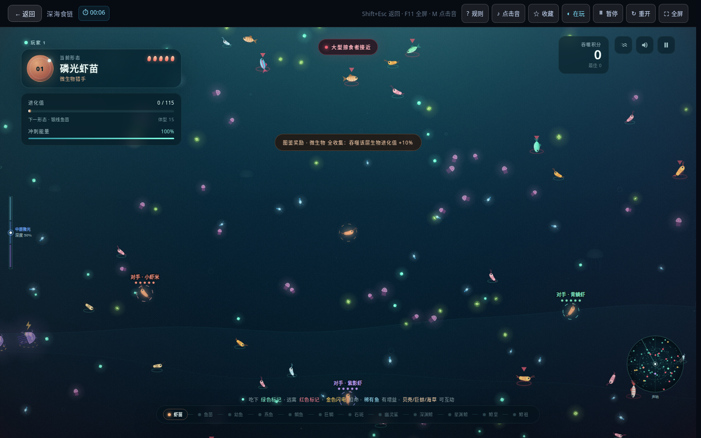
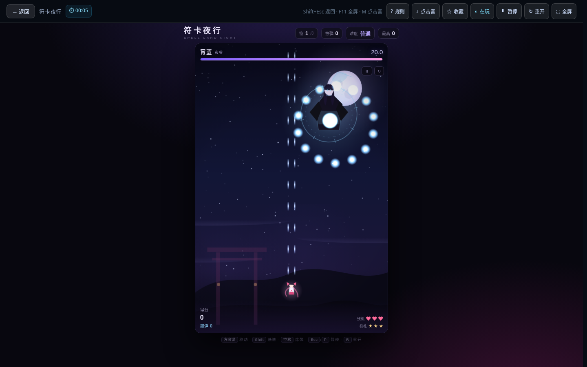
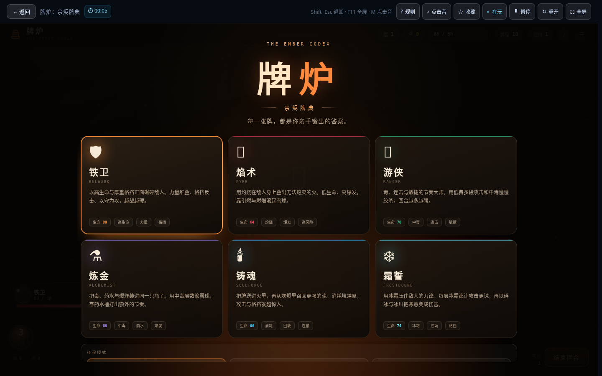
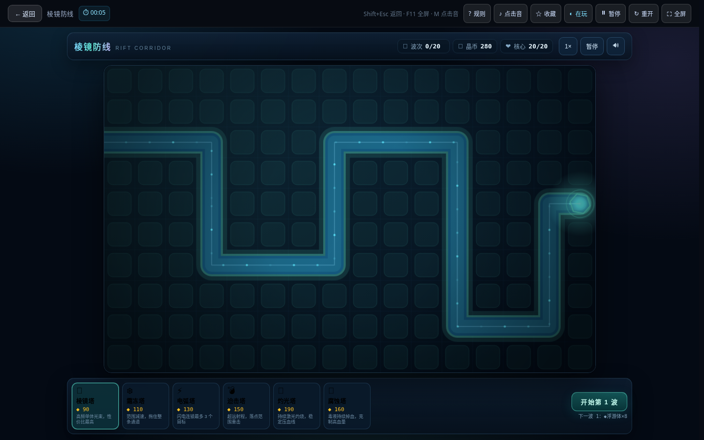
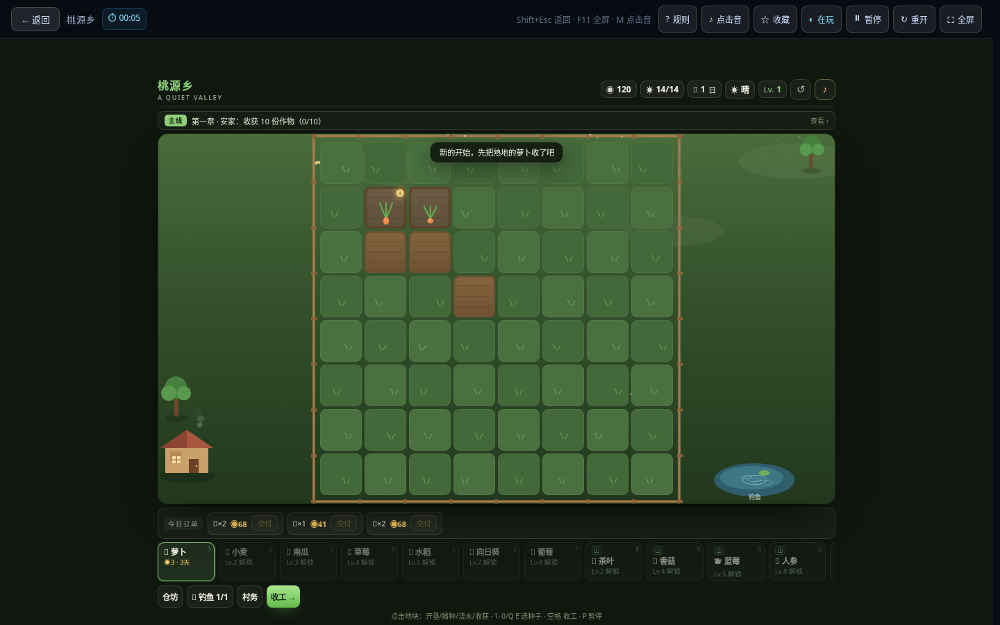
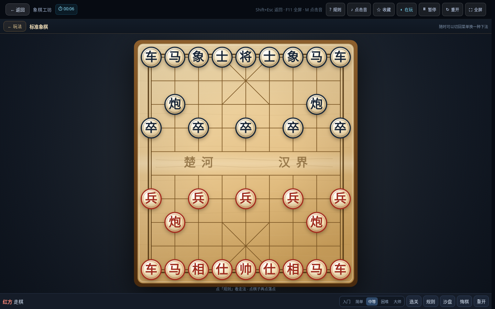
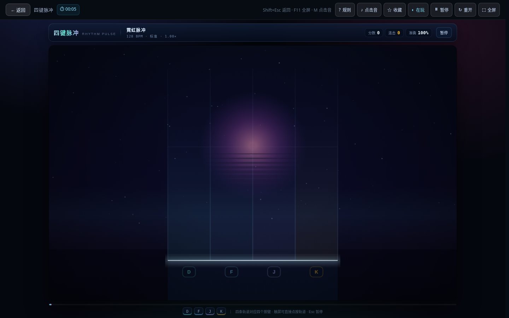
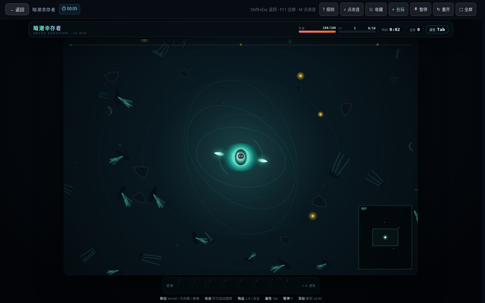

# 离线小游戏合集（80 款 · 纯前端单文件）

[](https://wuzhixing12.github.io/offline-minigames/)

80 个网页小游戏，全部用 HTML + CSS + 原生 JavaScript 写成，**零依赖、默认完全离线**。
双击一个 `index.html` 就能玩，断网也能玩；也可以打包成 Windows 桌面程序。需要跨设备时，可选登录邮箱同步存档。


## 特点

- **单文件**：80 款游戏全部内联在一个 7.7 MB 的 `index.html` 里，拷走一个文件就是整套合集
- **离线优先**：没有 CDN、没有外链字体，不登录时零联网，飞行模式下一样玩
- **可选云同步**（入口暂时下线）：用邮箱登录后，可在不同设备上传/下载整包存档（成绩、收藏、成就、游戏内进度）；不登录则一切只留本机
- **有存档**：最高分、关卡进度、做题记录都写 `localStorage`，全部包了 try/catch，存储被禁也不影响玩
- **有菜单**：搜索、11 大分类、难度筛选、S/A/B/C/D 评级筛选、排序、随机来一局、最近玩过、收藏
- **三列网格**：桌面端固定 3 列，窄屏自动降列，不会挤成一条
- **结构清晰**：根目录 `index.html` 是完整合集；`games/` 把 80 款逐一拆成独立 HTML，每款都能单独打开调试
- **持续更新**：分享成绩卡、成绩册可视化、进度标记与最近更新栏，玩过的进度和最佳成绩都留在本机

## 云同步（可选）

> **当前状态：入口暂时下线**（邮件服务未就绪）。匿名游玩统计不受影响；恢复时把 `index.html` 里的 `CLOUD_ON` 改回 `true` 即可。

设计上默认不联网。想在不同设备之间同步进度时，点右上角的 **☁ 云同步**，用邮箱收一封登录链接即可：

- 登录后点「上传本机存档」把当前进度存到云端，换台设备登录后点「从云端下载」恢复
- 上传/下载都是覆盖整个存档包（成绩、收藏、成就、游戏内进度），下载前会二次确认
- 后端使用 Supabase（Postgres + 邮箱魔法链接登录），数据库脚本在 [`supabase/schema.sql`](supabase/schema.sql)
- 只记录匿名游玩次数（游戏 id + 日期，不含账号、IP 或设备信息），用于统计热度
- 断网、未登录或云服务不可用时，游戏照常运行，所有云功能静默跳过
- Supabase 自带邮件服务有频率限制，正式使用建议在 Supabase 后台配置自己的 SMTP

## 截图

| | |
| --- | --- |
|  |  |
| 深海食链 · 12 段体型进化 | 符卡夜行 · 东方风弹幕 |
|  |  |
| 牌炉 · 肉鸽卡牌构筑 | 棱镜防线 · 塔防 |
|  |  |
| 桃源乡 · 四季田园经营 | 象棋工坊 · 标准 / 揭棋 / 盲棋 |
|  |  |
| 四键脉冲 · 四键下落音游 | 暗潮幸存者 · 自动攻击生存 |

**全部 80 款都有截图**，按游戏 id 命名保存在 [screenshots/](screenshots)（如 `snake.png`、`xiangqi.png`），选中任意一款即可查找。

## 80 款游戏

评级: **S** 强烈推荐 · **A** 很值得玩 · **B** 值得一试 · **C** 一般 · **D** 较冷门

### 🕹️街机动作 · 手速、走位与反应

| 游戏 | 说明 | 难度 | 时长 | 评级 |
| --- | --- | --- | --- | --- |
| **🐋** 深海食链 | 从磷光虾苗一路吞到归墟鲸祖：12 段体型进化、3 条航线、66 种海洋生物、3 个同源对手，深海分层、主动道具、海洋霸主与每日挑战一应俱全，支持单人、双人同屏和双人对决。 | 困难 | 8–25 分钟 | S |
| **🌀** 暗潮幸存者 | 深海裂隙里的自动攻击生存：环刃常驻、核心脉冲清场，19 种进化三选一；2 分钟起事件轮番来袭，5:00 与 9:00 两度首领苏醒，撑满 10 分钟等黎明。PC 端为可探索的宽幅地图。 | 困难 | 10–15 分钟 | S |
| **🌸** 符卡夜行 | 东方风纵版弹幕：小判定点擦弹加分，低速聚焦穿过弹雨，三颗星与炸弹挑战两位 BOSS 的六张符卡。 | 困难 | 5–15 分钟 | S |
| **🚀** 飞机大战 | 十关递进，每关在 1–2 分钟的随机时刻迎战 Boss，弹幕分瞄准/扇形/环形/螺旋；连击得分倍率、B 键清屏炸弹、护盾补给，Boss 低血量进入狂暴；自动开火，打完十关算通关。手机拖动屏幕移动。 | 困难 | 20–40 分钟 | S |
| **🗡️** 拼刀夜雨 | 雨夜里的拼刀决斗：看准刀光按弹反，攒满架势处决；三位剑客、两个阶段，药葫芦只有三只。 | 困难 | 5–15 分钟 | S |
| **🧱** 俄罗斯方块 | 四种玩法：冲刺 40 行、马拉松、禅意、限时 2 分钟，每种模式单独记最好成绩。手机可点下方按钮操作。 | 适中 | 5–20 分钟 | S |
| **⛏️** 黄金矿工 | 摆动的钩子对准金块、钻石与神秘袋，越重收得越慢；五层矿脉、55 秒一关，过关后升级卷扬与幸运。 | 适中 | 3–10 分钟 | A |
| **🧨** 打砖块 | 二十关砖墙，炸弹砖连锁爆炸、金砖三倍分；连击到 ×5 触发重击穿透，五种道具随机掉落，命数跨关继承。 | 适中 | 15–35 分钟 | A |
| **🪐** 星团吞噬 | 在远大于屏幕的星海里游走，吃掉更小的星团、躲开猎手和大小不一的红刺球；体型越大越慢，任何大球撞刺都会被扎掉体积。带名字的电脑玩家会抢食、互相吞噬。 | 适中 | 3–8 分钟 | A |
| **🧗** 登顶失败 | 按住蓄力、松手起跳，一跳一层往上爬。落空会掉回下层；260 层、2027 米的高塔，2027 顶峰不见不散。途中会有低语在耳边响起，嘲讽、反讽与加油交替。 | 困难 | 20–60 分钟 | A |
| **🏃** 屋顶线 | 雨夜屋顶无尽跑酷：跳过缺口、滑铲钻招牌，收集金币与护盾；支持二段跳、暂停和触屏按钮，距离越远节奏越快，最佳成绩本地保存。 | 适中 | 2–8 分钟 | A |
| **🏎️** 一线漂移 | 俯视夜路竞速：油门、刹车与手刹漂移，在弯心贴线甩尾攒加速；三条赛道，圈速与名次都记在本地。 | 适中 | 2–6 分钟 | A |
| **🎯** 弹珠夜航 | 从夜海小船发射弹珠，让它在钉阵里反复反弹，点亮橙色钉子；绿钉补球、紫钉五倍分，一颗球打出最长的连锁。 | 适中 | 3–10 分钟 | A |
| **🔮** 祖玛大师 | 经典祖玛玩法：射出彩珠插入轨道，三连以上消除，连锁爆发有额外加分。7 种轨道、9 种模式（经典 / 冒险 / 生存 / 计时 / 无尽 / 闪电 / 练习 / Boss / 每日）、三种技能与 Boss 战。 | 适中 | 3–10 分钟 | A |
| **🟡** 吃豆人 | 经典迷宫吃豆：吃光所有豆子过关，能量豆让幽灵变蓝可以反吃，连吃最高 1600 分。四只幽灵各有追踪逻辑，支持键盘、虚拟方向键和滑动操作。 | 适中 | 3–10 分钟 | A |
| **🔨** 打地鼠 | 三种模式任选：经典 45 秒、疾风 30 秒、生存挑战。普通鼠、金鼠、铁盔鼠（2 击）、地鼠王（3 击，加时或加命）和炸弹轮番出洞，连击 8 次进入狂热，得分翻倍。 | 轻松 | 1–5 分钟 | A |
| **🐍** 贪吃蛇 | 吃得越多越长越快，撞墙撞自己就结束。手机可直接滑动屏幕转向。 | 轻松 | 1–5 分钟 | B |
| **🔶** 环刃 | 六边形转盘上只靠左右旋转，躲开从边缘压来的墙；存活越久转得越快，活过 60 秒。 | 困难 | 1–5 分钟 | B |
| **⬡** 六边消消 | 彩块从六个方向压向中心，转动六边形让同色块连成三片消除；连击叠加倍率，分数越高节奏越快。 | 适中 | 3–10 分钟 | B |

### 🧠烧脑挑战 · 推理、规划与资源取舍

| 游戏 | 说明 | 难度 | 时长 | 评级 |
| --- | --- | --- | --- | --- |
| **🃏** 牌炉：余烬牌典 | 一款大幅扩展的肉鸽卡牌构筑：六大职业、211 张卡牌、56 件遗物、50 种敌人、23 种药水，标准 8 层 / 深层 24 层 / 无尽三种征程。每场战斗抽牌出牌攒能量，冰霜削敌、消耗回收、药水救场；状态牌与诅咒会污染牌组，营火、锻造、商店与 12 种随机事件改写构筑。还能挑战 0–10 级苦度、每日固定种子、成就、图鉴与战绩，击败守炉者后继续深入，把一套牌打磨到极致。 | 大师 | 30–60 分钟 | S |
| **🕵️** 雨夜疑云 | 五起雨夜案件，用自由落体、刹车距离、镜面反射、动量和声速把物理公式变成证据；每案比对数值后作答，最后指认真正的凶手。 | 困难 | 15–30 分钟 | S |
| **🎒** 背包乱斗 | 把武器、护甲和药草塞进有限的背包格，相邻摆放触发羁绊；摆好阵型后自动开打，一轮轮攒钱换更强的装备。 | 困难 | 10–25 分钟 | S |
| **🛡️** 棱镜防线 | 在裂隙回廊、双涡环流与折返深渊三张地图上建造棱镜、霜冻、电弧、迫击、灼光与腐蚀六种防御塔。包含精英词缀、波间三选一强化、无尽模式与最高纪录存档。 | 困难 | 15–40 分钟 | S |
| **🏠** 运气出租屋 | 海底出租屋的老虎机肉鸽：5×3 图案相邻加成，赚硬币付十期房租，间隙逛商店把更强的图案塞进摇奖机。 | 适中 | 5–15 分钟 | A |
| **🃏** 小丑赌局 | 牌桌肉鸽：从牌堆里选牌凑牌型，用筹码与倍率冲过盲注；小丑牌改写计分规则，商店里继续加码。 | 困难 | 15–40 分钟 | A |
| **📦** 推箱子 | 30 关由易到难，最少 1 推、最多 23 推，箱子只能推不能拉。 | 适中 | 15–40 分钟 | A |
| **💣** 扫雷 | 四种玩法：经典、环形边界、限时挑战、无旗；五档难度从 6×6 到 20×30，首点必安全。 | 适中 | 2–20 分钟 | A |
| **⬡** 六边形扫雷 | 六边形网格扫雷：每格六个邻格，首格必定安全。数字下方的 {2}/{3} 标出相邻雷的连片大小，{2}×2 表示两组各两颗。六档难度 37–217 格，支持右键或长按插旗、数字展开与本地最佳成绩。 | 适中 | 3–25 分钟 | A |
| **🖥️** 服务器求生 | 机房应急模拟：六台服务器同时出故障，分配电力抢修，控制负载与温度，扛过 180 秒。扩容、全机冷却和重启都是保命手段。 | 困难 | 3–5 分钟 | B |

### 🀄棋牌 · 象棋工坊、国际象棋、围棋与经典棋牌

| 游戏 | 说明 | 难度 | 时长 | 评级 |
| --- | --- | --- | --- | --- |
| **🐘** 象棋工坊 | 标准象棋、揭棋、盲棋三合一：标准局保留五档 AI、悔棋、沙盘推演与残局选关；揭棋暗子随机就位、落子翻明；盲棋 4×8 暗棋、首翻定色、按等级吃子。一个入口切换，附三种下法对比与规则速查。 | 大师 | 5–20 分钟 | S |
| **⚫** 围棋 · 手谈 | 9 / 13 / 19 路围棋，人机三档或同屏双人。提子、打劫、停手数子，点选死子即时判分；可悔棋，木纹棋盘随屏幕自适应。 | 困难 | 10–40 分钟 | S |
| **🏙️** 环城大亨 | 28 格环形地产争霸：16 处地产、2 座车站、2 家公用事业。买地、升级、收租、抵押与暗标拍卖，机会/社区卡、监牢、城市税、奖池与三种 AI 性格，40 回合后按总资产结算。 | 适中 | 20–45 分钟 | S |
| **⚫** 五子棋 | 19×19 大棋盘，人机对战与双人同屏（玩家 VS 玩家）。可切换 15×15、执黑/执白与五档 AI 难度（入门到大师），支持悔棋和重开。 | 适中 | 5–15 分钟 | A |
| **🎴** 夜宴斗地主 | 夜宴牌局主题的经典三人斗地主。1/2/3 分叫地主，3 分直接拿底牌；全新深色牌桌、实时记牌器与战报、AI 性格台词、合成音效和结算战绩。支持单张、对子、三带、顺子、连对、飞机、四带二、炸弹与王炸。 | 适中 | 3–15 分钟 | A |
| **♟** 象棋残局 | 300 局红先胜残局：前 60 关两步杀，61–180 关三步杀，181–300 关四步杀；开局先选关，每 40 关一页共 8 页。无提示，任何合法走法都能走，走错一步即告负；支持撤销、重来和本地进度保存。 | 大师 | 3–10 分钟 | A |
| **🃏** 纸牌接龙 | 克朗代克、蜘蛛与每日挑战三种玩法。支持翻 1/3 张、拖拽移动、撤销、提示、自动完成、主题切换、统计与胜利动画。 | 适中 | 15–40 分钟 | A |
| **⚫** 黑白棋 | 夹住对方的棋子就能翻转它，抢角、控边、算步数，三档 AI 从轻松到困难。 | 困难 | 5–15 分钟 | B |
| **🎴** 记忆翻牌 | 五种难度：新手 4×4、经典 5×4、疾速 6×4 限时、迷雾 5×6 重排、地狱 6×8 三条命。开局短暂亮牌预览，每种难度分别记录最佳步数与用时。 | 适中 | 2–20 分钟 | B |
| **♞** 国际象棋 | Gambit 国际象棋：完整规则的人机 / 双人对弈，支持王车易位、吃过路兵、兵升变、悔棋与翻转棋盘，并自动判定将死、逼和、子力不足、五十回合和三次重复。 | 困难 | 5–20 分钟 | B |

### 🌴休闲养成 · 慢节奏、攒进度、随时放下

| 游戏 | 说明 | 难度 | 时长 | 评级 |
| --- | --- | --- | --- | --- |
| **🌾** 桃源乡 | 双地图四季田园经营：村口 8×8 田地 + 后山 6×6 梯田，12 种作物、12 处设施、11 道加工、18 项成就、4 位村民与 6 章主线。开垦播种、浇水收获、接订单、送礼交心，从胡萝卜一路经营到后山茶与蜜桃，约 1.5 小时的桃源生活。进度自动保存，下次进入直接接着玩；右上角 ↺ 可清档重开。 | 入门 | 60–120 分钟 | S |
| **🌍** 此生来世 | 30 种投胎出身 + 16 个人生节点 + 97 个事件（34 个可做稳妥/冒险选择）+ 32 段命运插曲（含 6 段隐藏剧情与 6 条人生危机），10–15 分钟过完一生。开局先选志向：搞钱、成名、安稳、被爱、自由、留下作品，志向会影响评分与结局；每个出身和天赋都带一项缺点。幼儿园毕业时要亲手写下“长大以后想成为什么样的人”，这个目标会一路跟着你，最后可能如愿，也可能被生活带去别处；十八岁整理旧物时会再翻到那张纸，可以坚持、改写或收起。出身卡标注父母职业，选“像爸妈一样”时按真实职业判定。无论成为谁，都别忘了为人民谋幸福、为民族谋复兴。伴侣与挚友有名字、性格和共同记忆，职业分入行/骨干/负责人三级；进度自动存档可“继续上一世”，已读事件可快进，转世传承解锁额外天赋与全属性加成。21 句人生哲理、33 项成就、22 种结局可收集。 | 轻松 | 10–15 分钟 | S |
| **🎣** 潮汐垂钓 | 抛竿、等咬钩、控制收线张力。五个海域、47 种鱼、三系装备升级，潮汐与鱼群改变鱼情，委托和图鉴可玩 30–60 分钟。进度自动保存。 | 入门 | 30–60 分钟 | S |
| **🏙️** 方块城市 | 等距视角城市建造：在 8×8 地块上盖房子、农田、工坊和公园，平衡金币、粮食、人口与幸福度，扛住随机事件，把人口带到 40。支持 Q / E 或画面按钮 90° 平面旋转视角。 | 适中 | 10–25 分钟 | A |
| **🍒** 果核宇宙 | 把果实投进玻璃罐，相同两颗相撞就合成更大的果实。从微尘一路合到奇点，罐子越满越危险。 | 轻松 | 3–10 分钟 | B |

### ⚽球类游戏 · 球拍、球杆与弹道的物理玩法

| 游戏 | 说明 | 难度 | 时长 | 评级 |
| --- | --- | --- | --- | --- |
| **🎱** 黑八台球 | 黑八、9 球与练习模式。拖拽瞄准、松手击球，支持旋转塞球、双路径预测、三档 AI 对手与击球统计。 | 适中 | 10–30 分钟 | S |
| **🏓** 乒乓 | 四种玩法：经典对战、街机生存、10 关闯关、60 秒连击。旋转、蓄力重击、狂热大招与随机道具，球路越打越刁。 | 适中 | 10–40 分钟 | A |
| **🏀** 街篮火线 | 五种投篮模式：经典 60 秒、十球挑战、三条命生存、随机横风、移动小篮筐大师模式。拖动瞄准，松手出手；空心球与连中加成，最高分分模式保存在本机。支持鼠标、触屏和键盘。 | 轻松 | 1–2 分钟 | A |
| **🎯** 弹弓弹道 | 拉弓蓄力，把弹丸抛过障碍打中所有目标。重力、横风、弹道预览，弹丸大小每发随机（7–13），共 8 关。 | 适中 | 3–10 分钟 | A |
| **⛳** 迷你高尔夫 | 18 个洞的俯视高尔夫，沙地减速、水域罚杆，后九洞还有来回移动的挡板。 | 困难 | 10–30 分钟 | B |
| **🏒** 极光冰球 | 和 AI 对打的空气冰球，先到 7 分获胜。鼠标或手指拖动球拍，节奏快、单局短。 | 轻松 | 2–6 分钟 | B |

### 🎵音乐节奏 · 跟着节拍击打，手感与节奏的较量

| 游戏 | 说明 | 难度 | 时长 | 评级 |
| --- | --- | --- | --- | --- |
| **🎵** 四键脉冲 | 四键下落音游：六首曲目、三档难度、判定校准、滚动速度、长按音符、打击音效与 BEST 成绩存档。 | 适中 | 5–15 分钟 | S |
| **🎹** 星河琴键 | 八键落音：左手 A S D F、右手 J K L ; 分列左右两块，音符落到判定线时按下对应琴键，亲手把 8 首旋律弹出来；三档难度、经典与禅意模式，成绩本地保存。 | 适中 | 3–10 分钟 | A |

### 👥双人游戏 · 同屏合作或对战，两个人一起玩

| 游戏 | 说明 | 难度 | 时长 | 评级 |
| --- | --- | --- | --- | --- |
| **👬** 双生同系 | 一根绳子拴住两个角色，三十关平台、尖刺与弹跳板。两人靠近共鸣水晶充能，Enter 一起冲刺；金币按最佳收集评级，首通额外奖励，商店共 15 件绳子、拖尾与角色配色。 | 大师 | 15–30 分钟 | S |
| **🛡️** 坦克对战 | 三种模式同屏坦克对战：玩家对玩家、单人挑战电脑、双人合作打电脑。电脑火力已调温和。 | 适中 | 3–10 分钟 | A |
| **💣** 雷区派对 | 迷宫放炸弹，炸开软墙、连锁引爆并淘汰对手。单人挑战两名 AI，双人同屏先赢两局；吃道具增加炸弹数与火力。 | 适中 | 3–10 分钟 | A |
| **🔗** 双生回路 | 一根光绳连接两个灵魂，收集全部核心后两人同时进入传送门。十五层关卡含新手试炼，可从选关界面直接挑战任意一层，难度可调。 | 适中 | 15–35 分钟 | B |
| **🔥** 烬与汐 | 火娃与水娃的双人协作解谜：各自免疫火与水的伤害，躲开酸液，同时踩下机关打开石门，一人一扇门走出三十座元素神殿。七幕主题、关卡路标与更复杂的机关组合，每关带计时、宝石收集与三星评价。 | 困难 | 50–100 分钟 | S |

### 📚英语词汇 · 小初高 3000 词、四级词汇与拼写复习

| 游戏 | 说明 | 难度 | 时长 | 评级 |
| --- | --- | --- | --- | --- |
| **🔤** 词雷达 | 2000 个四级常见词，六种玩法：经典闯关、极速 60 秒、看中文拼英文、三条命生存、错题重练、智能复习。智能复习按记忆曲线推到期词并补新词；每题可发音，答对展示例句，答错给正确答案，词表与错词本记录掌握状态。 | 适中 | 3–12 分钟 | A |
| **🫧** 单词泡泡 | 3000 个小学到高中核心词，点破正确气泡：英译中、中译英、混合、60 秒冲刺、错词重练、智能复习六种玩法，三档难度。智能复习到期词优先；点错或超时给出完整单词、音标与释义并自动收进错词表，答对一次即移出；支持朗读开关与逐词发音。 | 轻松 | 3–10 分钟 | A |

### 🧩图形解谜 · 观察、匹配与空间想象

| 游戏 | 说明 | 难度 | 时长 | 评级 |
| --- | --- | --- | --- | --- |
| **🚪** 第七个房间 | 三间连锁密室：点场景找线索、把道具用在正确的位置，解开密码锁、接线和符号顺序谜题，最后在铁门前做出选择；两种结局，进度自动保存。 | 困难 | 20–40 分钟 | S |
| **🪢** 回路 | 六块手绘面板，从起点拖出一条不间断的线接到终点。绕开石墙、经过金色符文、让黑白点相邻，没有唯一答案。 | 适中 | 10–20 分钟 | A |
| **💎** 消消乐 | 20 关目标制：分数关、收集颜色关、清冰块关，冰块要贴着消除才能破。 | 轻松 | 5–10 分钟 | A |
| **🐑** 羊群叠叠 | 层叠牌堆三消：只能点最上层的牌，七格槽满了就散群；撤回三次、洗牌两次，十关牌堆越叠越大。 | 适中 | 8–20 分钟 | A |
| **🍉** 水果连连看 | 两张相同的水果，最多拐两个弯就能连起来。清空果盘过关，连击会加倍、配对能回补时间，死局自动重排。 | 轻松 | 5–15 分钟 | B |
| **🌀** 迷宫 | 随机生成只有一条通路的迷宫，从左上角一路摸到右下角。三档尺寸由小到大，并保证最短通路足够长；走不动时可以让提示画出路线，代价按难度递增。 | 困难 | 5–20 分钟 | B |
| **🚰** 水管连通 | 旋转水管把水源接到出水口，5 个关卡由浅入深，通水瞬间自动判定。 | 适中 | 5–15 分钟 | B |
| **🔎** 找不同 | 26 个场景随机轮换，简单 / 普通 / 困难三档各自找 3 / 4 / 5 处差异，限时找齐才能过关。 | 适中 | 15–40 分钟 | C |
| **🧩** 15 数字拼图 | 把 1–15 数字滑块推回原位，极光夜景插画与数字提示双模式，支持滑动操作。 | 轻松 | 3–10 分钟 | D |

### 📖文字语言 · 成语、汉字与对仗的文字游戏

| 游戏 | 说明 | 难度 | 时长 | 评级 |
| --- | --- | --- | --- | --- |
| **🖼️** 看图猜成语 | 666 条成语题库，入门 / 进阶 / 挑战三档难度，四选一限时作答；另有不给选项的特殊关卡，四个空格逐字猜，提交后告诉你对了几个字。 | 适中 | 2–10 分钟 | A |
| **✍️** 汉字找茬 | 338 组形近字，六种玩法：经典、极速、生存、幻影、双子、瞬移；点错扣时，提示会花时间。 | 入门 | 1–3 分钟 | B |
| **🧧** 对联配对 | 666 副对联，5 / 10 / 15 副一组可选；做过的自动记住不重复，配不上可跳过。 | 适中 | 3–8 分钟 | C |

### 🔢数字益智 · 数字、图案与逻辑推演

| 游戏 | 说明 | 难度 | 时长 | 评级 |
| --- | --- | --- | --- | --- |
| **🔢** 2048 | 滑动合并数字，目标是 2048。上手十秒，想放弃要很久。 | 轻松 | 3–10 分钟 | A |
| **🔢** 数独 | 三档难度、唯一解出题，笔记模式、冲突提示，卡住可以求提示。 | 困难 | 10–30 分钟 | B |
| **🧩** 数织 | 按行列提示涂格子，涂完是一幅画。23 幅图案（5×5 / 10×10 / 15×15），全部纯逻辑可解。 | 困难 | 5–20 分钟 | B |
| **🌉** 数桥 | 数字是这座岛需要的桥数，最多两座；桥不能交叉，所有岛必须连成一片。13 / 20 / 27 岛三档随机出题。 | 适中 | 5–15 分钟 | B |
| **➰** 数回 | 把数字连成一个闭环：沿线画边，每个数字周围恰好有该数量的线，所有线最终连成唯一一条首尾相接的回路。三档难度 6×6–8×8，每题现场生成保证有解，附撤销、提示、笔刷切换、验证与本地最佳成绩。 | 适中 | 5–20 分钟 | B |
| **🃏** 24 点 | 三档难度，每题都保证有解；连击加分，挑战档 60 秒倒计时，卡住可看参考解法。 | 适中 | 2–10 分钟 | C |
| **🧮** 数字华容道 | 3×3 到 5×5，拖动或轻扫棋盘即可滑动数字，步数与用时都记最佳。 | 适中 | 3–10 分钟 | D |

## 三种玩法

| 方式 | 怎么做 | 适合 |
| --- | --- | --- |
| 在线玩 | 打开 [在线试玩](https://wuzhixing12.github.io/offline-minigames/) | 手机上随手点开 |
| 网页版 | 下载 `index.html`，双击用浏览器打开 | 断网 / 机房 |
| 桌面版 | 用 Neutralino.js 把 `index.html` 打包成 exe | 想双击即开 |

桌面版的思路：`neutralino.config.json` 里把 `documentRoot` 指向资源目录，`index.html` 放进去，
`neu build --release` 会产出 `exe + resources.neu` 两个文件，放在同一目录即可运行。

## 目录结构

```
.
├── index.html          # 单文件版：80 款全在里面，Pages 就是用它
├── games/              # 80 款游戏各自独立的源码，一款一个 HTML
│   ├── tetris.html
│   ├── sokoban.html
│   └── ...
├── screenshots/        # README 与仓库主页用的截图
├── build.py            # 漂移检测 / 内联同步 / 新游戏骨架
├── .buildignore        # 独立维护、不要求合进合集的白名单
├── CONTRIBUTING.md     # 贡献指南
├── SECURITY.md         # 安全说明
├── .github/            # Pages 部署、CI 检查、Issue/PR 模板
└── README.md
```

## 更新日志

### 2026-11-24 · v1.50

- 《羽刃 · 夜场对决》重写为 v2.1：四种赛制（快速 / 标准 / 挑战 / 自由练习）、三档难度、羽刃时刻必杀、击球质量与落点提示，补上局间与赛后面板、15 项成就、生涯统计、设置项与三种球场主题。
- 球路从 8 种扩到 13 种：新增推球、勾对角、劈吊、网前扑球与挡网，巧打 / 快攻两套意图键配合站位自动选招。
- 手感与表现：击球冲击环、得分落地波纹、看台闪光、按球路分色的拖尾与重击速度线；AI 增加擦身容错、反应减速与回球质量约束，站对位置不再漏球。
- 全部 80 款游戏统一加上局内暂停：顶部工具栏一键冻结，动画、计时器与音效一起停，继续后从原时间点接上；自带 Esc 菜单的游戏不抢键位。
- 复核 80 款的分类 / 难度 / 预计时长 / 好玩度标注并清掉重复定义；抬头、页脚、更新日志三处版本号统一，去掉残留的旧版本号。

### 2026-11-24 · v1.49

- 新增羽毛球对决《羽刃 · 夜场对决》：三种赛制、三局两胜，蓄力控制高远 / 平抽 / 吊球 / 起跳杀球；落点标记与击球范围提示配合自动接球，手机双指可边移动边蓄力。
- 新增谈判博弈《暗盘》：雾港六夜、六位卖家与六件旧货，靠试探、施压、诈价与沉默把成交价压到底价与市价之间。
- 《背包乱斗》大幅重做：物品池扩到 50 件、三件同名自动合成升级、羁绊联动、战利品三选一、主动技能与持续伤害、三档难度、每日挑战、无尽模式与 8 项成就。
- 《拼刀夜雨》新增毒影、铜钟僧、双生剑客、雷弦、剑圣 5 名对手，旅程扩展为八阵，并加入三档难度。
- 《弹珠夜航》扩到 12 关并改为按目标分数过关；《弹弓风暴》扩展为 30 关三章战役，加入每日固定种子与无尽模式。
- 《符卡夜行》加入简单 / 普通 / 困难三档难度、两张新符卡、符卡练习与暂停；《雨夜疑云》扩到三章共 15 起案件。
- 《屋顶疾跑》加入磁铁、时缓、双倍、冲刺、弹簧五种道具；《环城大亨》《黄金矿工》《九宫数独》《一线漂移》《运气出租屋》同步扩展。
- 全部游戏按 S / A / B / C / D 重新评级，合集扩至 **80 款**、11 个分类，单文件约 7.6 MB。

### 2026-11-23 · v1.31

- 入口验证答对后 **30 天内不再弹出**；到期或清除浏览器数据后重新验证，状态只保存在本机。
- 《烬与汐》重新打包为 30 关美术升级版，恢复平台、背景、元素池、闸门、机关、检查点、宝石与角色的重绘版本。

### 2026-11-23 · v1.30

- 《此生来世》结局判定重做：32 种结局重新排序并加独立条件，教师、医护、造物者、守夜人、归田各有明确门槛；SSS 收紧到约 5%，旧存档自动迁移到新的年龄节点。
- 人生哲理按年龄分层，六岁写志向、十八岁翻旧纸改为按年龄触发；二十九岁新增回乡务农路线，人生档案馆显示事件与结局收集进度。

### 2026-11-23 · v1.29 英语游戏学习化

- 《词雷达》新增智能复习：按 10 分钟 / 1 小时 / 1 天 / 3 天 / 7 天 / 21 天的记忆曲线推到期词，不够再补新词，并显示已掌握、学习中、今日待复习。
- 《词雷达》加入单词发音与朗读开关；答对反馈展示例句，答错、词表和错词表都提供「听」按钮与掌握状态标签。
- 《单词泡泡》新增智能复习模式与记忆状态行；点错或超时给出完整单词、音标和释义，不再只提示答错；加入朗读开关、题目区「听」与答后答案行。
- 两款英语游戏补充了玩法规则与操作说明，嵌入合集时对源码中的 `&` 做了实体转义，运行内容与源文件一致。

### 2026-11-23 · v1.28 小体量游戏扩展

- 《弹弓风暴》扩展到 20 关，加入装甲、移动与奖励靶，以及连击、星级评价和关卡解锁进度。
- 《空气曲棍球》支持 3 档难度与 5 / 7 / 11 分赛制，新增蓄力重击、回合与球速 HUD、暂停和最佳纪录。
- 《迷宫》新增 5 种模式（含巨型迷宫与每日种子）、可收集星星、出口锁定与三星评价。
- 《环刃》升级为 4 种模式，新增护盾能量、过环得分和分模式最佳纪录。
- 《果核宇宙》加入经典 / 计时 / 疾速三种模式、9 种星体图鉴、4 枚成就徽章与分模式最高分。

### 2026-11-23 · 《烬与汐》美术升级与关卡修正

- 重绘背景：分层星空、星云、远山轮廓、神殿立柱与拱门，平台加入石纹、倒角、铆钉与凿痕。
- 重绘元素与机关：熔岩、深水、酸池加入流动波纹、气泡、泡沫与热浪粒子；闸门、机关、检查点、传送门全部重做，加入能量场、旗帜飘动与门内旋涡。
- 宝石加入轨道环与星芒，角色加入轮廓光与环绕光点，尘埃改为柔光光点。
- 修正关卡：移出落在致命地形中的宝石，挪开与出生点重叠的机关，调整少数检查点与闸门位置，避免误解与无意义开门。

### 2026-11-23 · 《烬与汐》30 关扩展

- 《烬与汐》再增加 10 关，总计 **30 关**，新增第六幕「星坠长廊」与第七幕「烬汐终局」，各自一套主题配色。
- 新增双子星桥、星海孤屿、星核三重门、双色迷城、终焉回环等结构：熔石与水石分属两人、三闸门回环、需要折返的同步机关。
- 星级上限同步提升到 **90 星**，旧存档的解锁进度与星级继续有效。

### 2026-11-23 · 《烬与汐》20 关扩展

- 《烬与汐》从 5 关扩展到 **20 关**，分为熔火、潮汐、镜湖、熔心、深渊五幕，每幕一套主题配色。
- 新增关卡检查点「路标」：倒下后从最近点亮的路标复活；新增双塔、断桥、环形深渊、三重闸门等结构。
- 原有五关保留并加入路标；旧存档的解锁进度与星级继续有效。

### 2026-11-22 · v1.26

- 合集调整为 **78 款**：新增双人协作解谜《烬与汐》；《楚河汉界》《揭棋》《盲棋》合并为《象棋工坊》；移除《地洞吞噬》。
- 新增入口验证「LYH喜欢谁？」；电脑端显示「提示：三个字」，手机端隐藏。
- 全部游戏重新校准五档难度；成就扩充到 **45 项**，新增「五档通吃」「大师之路」，并下调累计局数、单款时长等门槛。
- `index.html` 同步至 v1.26，单文件约 7.5 MB，仍为零依赖、零网络请求。

### 2026-11-22 · 80 款阶段

- 合集从 50 款扩到 **80 款**，新增 30 款：夜宴斗地主、棱镜防线、纸牌接龙、黑八台球、四键脉冲、环城大亨、此生来世、暗潮幸存者、果核宇宙、环刃、雷区派对、登顶失败、地洞、回路、运气出租屋、围棋 · 手谈、小丑赌局、弹珠夜航、背包乱斗、一线漂移、拼刀夜雨、符卡夜行、羊群叠叠、黄金矿工、星河琴键、揭棋、盲棋、屋顶线、第七个房间、雨夜疑云
- 棋牌新增 **揭棋** 与 **盲棋**，棋牌分类扩充到 12 款；同时新增围棋 · 手谈、环城大亨、黑八台球、纸牌接龙等
- **深海食链** 升级为 **12 段体型进化**：三条航线各新增两段终极形态，同源对手与终盘海洋霸主同步强化；后期进化值需求上调，满级总需求提升到 8360，前 7 段节奏保持不变
- 新增 **分享成绩卡**、**成绩册可视化**、**进度标记** 与 **最近更新** 栏
- 菜单扩展到 **11 大分类**，新增音乐节奏与英语词汇两类
- 全部 80 款仍内联在单个 `index.html` 中，纯前端、零网络请求，双击即可离线开玩

### 2026-11-21

- 合集从 25 款扩到 **45 款**，新增 21 款：数桥、迷宫、水果连连看、双生同系、双生回路、星团吞噬、弹弓弹道、迷你高尔夫、极光冰球、潮汐垂钓、中国象棋、象棋残局、国际象棋、六边消消、吃豆人、方块城市、服务器求生、桃源乡、深海食链、街球时刻、祖玛大师
- 桌面端固定 **3 列**网格，宽屏不再出现 4 列
- 搜索栏的时长筛选改为 **S/A/B/C/D 评级筛选**，可按推荐程度过滤
- **服务器求生** 时长 120 → 180 秒，节奏更完整
- **中国象棋** 调整为大师难度，**推箱子** 调整为适中，**深海食链** 调整为困难
- **2048** 只保留原版，移除磁贴版
- 交互优化：Esc 不再误退出游戏，改为 **Shift+Esc** 返回；播放层焦点隔离，Tab 不再跳到背后菜单；手机端触摸顶部即可唤出顶栏
- 支持 `#游戏id` 深链，浏览器后退可直接回到列表；顶栏「音效」更名「界面音效」，明确只控制界面提示音
- 框架与美术：新增顶部品牌栏与「跳到游戏列表」无障碍链接；每张游戏卡加入分类主题色发丝线、图标网格纹理和大号角色水印；成就墙改为 27 点阵进度；分类标题与图标接入各自主题色
- 移动端：卡片改为图标在左、信息在右的横向紧凑布局，推荐卡参数改为 2×2 栅格；播放顶栏改为悬浮胶囊，避免遮挡游戏 HUD；新增 560 / 480 两档断点
- 键盘与交互：卡片改为整卡覆盖按钮，保留右上角收藏星的独立点击区；Enter 可直接开始游戏；收藏、随机推荐、列表切换均可用键盘操作
- **祖玛大师** 自检修正为临时切到 easy 难度再检测，启动不再输出自检失败日志
- **星团吞噬** 加入完整食物链：大球可以吃小球，6 名带名字的电脑玩家会抢食、互相吞噬、躲避更大的球和刺球，被吃的球在远处重生；开局 5 秒安全期，避免刚进场就被猎手堵住
- **双生同系** 从 20 关扩到 **30 关**，新增第三章「共鸣」：两人同时靠近共鸣水晶充能，按 Enter 一起冲刺并短暂拉长绳子；选关地图改为三章曲线布局
- **双生同系** 新增金币评级与外观商店：按每关最佳金币收集率评 S / A / B，金币按最佳成绩入账，可解锁霓虹、极光绳子，星尘、气泡拖尾，以及深海、糖果角色配色
- **双生同系** 关卡按综合难度重排为 1–30（宽度、坑洞、尖刺与机关密度），旧存档与金币记录按原始关卡编号自动对应；外观商店价格下调为绳子 25/65、拖尾 30/60、角色 35/65 金币

### 2026-11

- **看图猜成语** 题库 60 → 210 条，可扣分换提示，没答对过的优先出
- **对联配对** 50 → 313 副，可跳过，做过的记住不重复
- **汉字找茬** 78 → 338 组形近字，带进度存档
- **找不同** 6 → 12 个场景，差异 3/4/5 处逐关递增
- **数织** 图案 12 → 23 幅，全部经过程序验证「纯逻辑可解」
- **俄罗斯方块** 四种玩法：冲刺 40 行 / 马拉松 / 禅意 / 限时 2 分钟
- **打砖块** 5 → 10 关，炸弹砖、金砖、四种道具
- **飞机大战** 5 关递进，每关末尾一场 Boss 战
- **24 点** 三档难度，出题保证有解
- **消消乐** 20 关目标制
- **推箱子** 8 → 20 关，每关的最少推动次数都由 BFS 求解器算过

### 2026-11-18

- **对联配对** 313 → 1000 副，加 5 / 10 / 15 副三档难度，配错扣分、用时越短奖励越高，每档单独记最佳
- **数字华容道** 支持鼠标拖拽移动方块（原来只能点）
- **扫雷 / 坦克对战** 细节调整

## 开发

### 目录职责

| 路径 | 说明 |
| --- | --- |
| `index.html` | **80 款完整合集，单个 7.7 MB 文件**。每款游戏的完整 HTML 以 `<textarea id="src-*" hidden>` 内联在主文档里，运行时塞进 iframe 的 `srcdoc` |
| `games/*.html` | 从 `index.html` 拆出的 80 款独立源码，文件名即游戏 id，双击即可单独游玩 / 调试 |
| `screenshots/` | README 和仓库主页要用的截图 |
| `build.py` | 构建辅助脚本（漂移检测 / 内联同步 / 新游戏骨架） |
| `.buildignore` | 声明哪些 `games/*.html` 是独立维护、不要求在 `index.html` 里出现的 |
| `.github/workflows/pages.yml` | GitHub Pages 自动部署 |

### 本地调试

合集本身是纯静态文件，双击 `index.html` 就能玩。如果要本地起个 server（需要深链 / iframe 加载时更稳）：

```bash
cd offline-minigames
python3 -m http.server 8000
# 浏览器打开 http://localhost:8000
```

单独调试某款游戏：直接双击 `games/<id>.html`，80 款都有独立文件。

### 修改已有游戏

`index.html` 仍是唯一事实来源：**改 `index.html` 里对应的 `<textarea id="src-*">` 内容**，改完本地预览确认无误再提交。`games/*.html` 是它拆出来的副本，改完后可顺手同步一份，方便单独打开和对比。

### 新增一款游戏

```bash
# 1) 用 build.py 生成骨架（会同时创建 games/<name>.html 并在 index.html 末尾占位）
python3 build.py new  mycoolgame

# 2) 编辑 games/mycoolgame.html 写游戏逻辑
#    （index.html 里已经有一段 <!-- INLINE: mycoolgame --> ... <!-- /INLINE: mycoolgame -->）

# 3) 跑 inline 同步（如果 games/mycoolgame.html 后续还有改动）
python3 build.py inline

# 4) 把 index.html 末尾的菜单占位注释替换为真实菜单项
#    - 分类（11 类）
#    - 难度（轻松 / 适中 / 困难 / 大师）
#    - 时长（如 3–10 分钟）
#    - 评级（S / A / B / C / D）
#    - README 里「80 款游戏」章节也加一行
```

### 漂移检测

```bash
python3 build.py check
```

输出 `games/*.html` 与 `index.html` 的漂移（哪些文件在 `games/` 里但 `index.html` 里完全找不到）。白名单写在 `.buildignore` 里——那些是有意独立维护、不要求合进合集的。

### 打包成 Windows 桌面程序

README 里提到用 Tauri / Neu 打包：`neu build --release` 会产出 `exe + resources.neu`，放在同一目录即可运行。`tools/`、`neu/` 已在 `.gitignore` 里，不会被提交。

## 说明

- 所有游戏都是纯代码绘制，没有外部图片与音频，因此体积很小、也能完全离线
- 不登录时存档只在本机浏览器里，不会上传；登录云同步后，存档会上传到你自己项目的 Supabase（仅你本人可读写）
- 代码可自由参考、修改、二次分发
