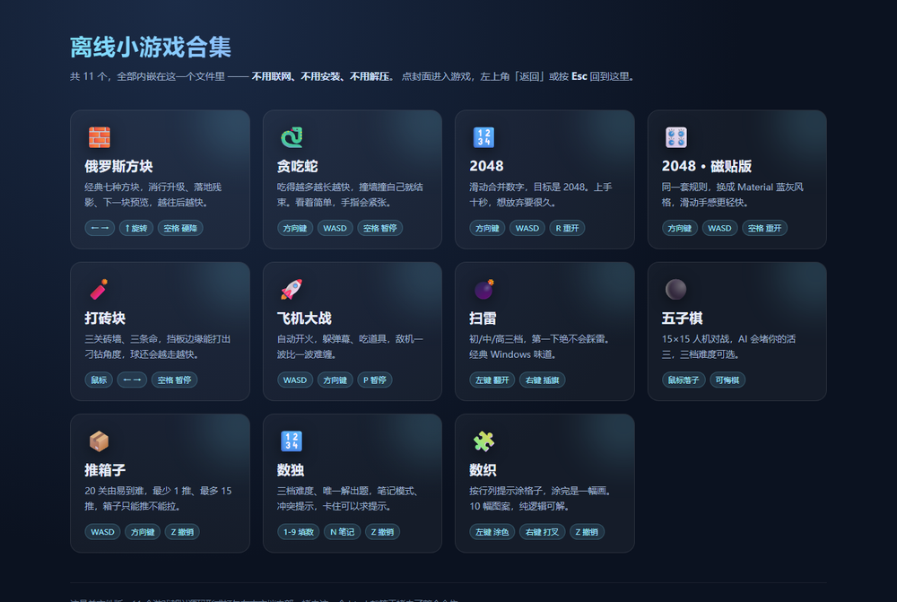

# 离线小游戏合集（45 款 · 纯前端单文件）

[](https://wuzhixing12.github.io/offline-minigames/)

45 个网页小游戏，全部用 HTML + CSS + 原生 JavaScript 写成，**零依赖、零网络请求、零追踪**。
双击一个 `index.html` 就能玩，断网也能玩；也可以打包成 Windows 桌面程序。



## 特点

- **单文件**：45 款游戏全部内联在一个 2.9 MB 的 `index.html` 里，拷走一个文件就是整套合集
- **离线**：没有 CDN、没有外链字体、没有埋点，飞行模式下一样玩
- **有存档**：最高分、关卡进度、做题记录都写 `localStorage`，全部包了 try/catch，存储被禁也不影响玩
- **有菜单**：搜索、9 大分类、难度筛选、S/A/B/C/D 评级筛选、排序、随机来一局、最近玩过、收藏
- **三列网格**：桌面端固定 3 列，窄屏自动降列，不会挤成一条
- **结构清晰**：根目录 `index.html` 是完整合集；`games/` 保留早期 25 款的独立源码，方便单独修改

## 45 款游戏

评级：**S** 强烈推荐 · **A** 很值得玩 · **B** 值得一试 · **C** 一般 · **D** 较冷门

### 🕹️ 街机动作 · 手速、走位与反应

| 游戏 | 说明 | 难度 | 时长 | 评级 |
| --- | --- | --- | --- | --- |
| **🧱** 俄罗斯方块 | 四种玩法：冲刺 40 行、马拉松、禅意、限时 2 分钟，每种模式单独记最好成绩。 | 适中 | 5–20 分钟 | S |
| **🐍** 贪吃蛇 | 吃得越多越长越快，撞墙撞自己就结束。看着简单，手指会紧张。 | 轻松 | 1–5 分钟 | A |
| **🧨** 打砖块 | 二十关砖墙，炸弹砖连锁爆炸、金砖三倍分；连击到 ×5 触发重击穿透，五种道具随机掉落，命数跨关继承。 | 适中 | 15–35 分钟 | A |
| **🚀** 飞机大战 | 五关递进，每关末尾一场 Boss 战，弹幕分瞄准/扇形/环形/螺旋；自动开火，打完五关算通关。 | 困难 | 5–15 分钟 | S |
| **🔨** 打地鼠 | 45 秒内敲中冒头的地鼠，金鼠加分、炸弹扣时间，连击越高分越猛。 | 入门 | 1–3 分钟 | C |
| **🪐** 星团吞噬 | 在远大于屏幕的星海里游走，吃掉更小的星团、躲开猎手和大小不一的红刺球；体型越大越慢，任何大球撞刺都会被扎掉体积。 | 适中 | 3–8 分钟 | A |
| **⬡** 六边消消 | 彩块从六个方向压向中心，转动六边形让同色块连成三片消除；连击叠加倍率，分数越高节奏越快。 | 适中 | 3–10 分钟 | B |
| **🟡** 吃豆人 | 经典迷宫吃豆：吃光所有豆子过关，能量豆让幽灵变蓝可以反吃，连吃最高 1600 分。四只幽灵各有追踪逻辑，支持键盘、虚拟方向键和滑动操作。 | 适中 | 3–10 分钟 | B |
| **🐋** 深海食链 | 从磷光虾苗一路吞到星渊鲸王：10 段体型进化、3 条航线、3 个同源对手，深海分层、主动道具、海沟之主与每日挑战一应俱全，支持单人、双人同屏和双人对决。 | 困难 | 5–20 分钟 | S |
| **🔮** 祖玛大师 | 经典祖玛玩法：射出彩珠插入轨道，三连以上消除，连锁爆发有额外加分。7 种轨道、9 种模式（经典 / 冒险 / 生存 / 计时 / 无尽 / 闪电 / 练习 / Boss / 每日）、三种技能与 Boss 战。 | 适中 | 3–10 分钟 | B |

### 👥 双人游戏 · 同屏合作或对战，两个人一起玩

| 游戏 | 说明 | 难度 | 时长 | 评级 |
| --- | --- | --- | --- | --- |
| **🛡️** 坦克对战 | 三种模式同屏坦克对战：玩家对玩家、单人挑战电脑、双人合作打电脑。电脑火力已调温和。 | 适中 | 3–10 分钟 | A |
| **👬** 双生同系 | 一根绳子拴住两个角色，二十关平台、尖刺与弹跳板。谁掉下去都算两个人的，配合比手速更重要。 | 大师 | 15–30 分钟 | A |
| **🔗** 双生回路 | 一根光绳连接两个灵魂，收集全部核心后两人同时进入传送门。十层关卡，难度可调。 | 适中 | 10–25 分钟 | B |

### 🔢 数字益智 · 数字、图案与逻辑推演

| 游戏 | 说明 | 难度 | 时长 | 评级 |
| --- | --- | --- | --- | --- |
| **🔢** 2048 | 滑动合并数字，目标是 2048。上手十秒，想放弃要很久。 | 轻松 | 3–10 分钟 | A |
| **🧮** 数字华容道 | 3×3 到 5×5，拖动或轻扫棋盘即可滑动数字，步数与用时都记最佳。 | 适中 | 3–10 分钟 | D |
| **🃏** 24 点 | 三档难度，每题都保证有解；连击加分，挑战档 60 秒倒计时，卡住可看参考解法。 | 适中 | 2–10 分钟 | C |
| **🔢** 数独 | 三档难度、唯一解出题，笔记模式、冲突提示，卡住可以求提示。 | 困难 | 10–30 分钟 | B |
| **🧩** 数织 | 按行列提示涂格子，涂完是一幅画。23 幅图案（5×5 / 10×10 / 15×15），全部纯逻辑可解。 | 困难 | 5–20 分钟 | B |
| **🌉** 数桥 | 数字是这座岛需要的桥数，最多两座；桥不能交叉，所有岛必须连成一片。13 / 20 / 27 岛三档随机出题。 | 适中 | 5–15 分钟 | B |

### 🧠 烧脑挑战 · 推理、规划与资源取舍

| 游戏 | 说明 | 难度 | 时长 | 评级 |
| --- | --- | --- | --- | --- |
| **💣** 扫雷 | 四种玩法：经典、环形边界、限时挑战、无旗；五档难度从 6×6 到 20×30，首点必安全。 | 适中 | 2–20 分钟 | A |
| **📦** 推箱子 | 30 关由易到难，最少 1 推、最多 23 推，箱子只能推不能拉。 | 适中 | 15–40 分钟 | S |
| **🖥️** 服务器求生 | 机房应急模拟：六台服务器同时出故障，分配电力抢修，控制负载与温度，扛过 180 秒。扩容、全机冷却和重启都是保命手段。 | 困难 | 3–5 分钟 | C |

### 🀄 棋牌 · 象棋、五子棋、黑白棋与翻牌记忆

| 游戏 | 说明 | 难度 | 时长 | 评级 |
| --- | --- | --- | --- | --- |
| **⚫** 五子棋 | 19×19 大棋盘，人机对战与双人同屏（玩家 VS 玩家）。可切换 15×15，三档 AI 难度，支持悔棋和重开。 | 适中 | 5–15 分钟 | A |
| **🎴** 记忆翻牌 | 翻开卡片记住位置，把成对的图案全部配对。三种棋盘，步数和用时都记最佳。 | 入门 | 2–6 分钟 | C |
| **⚫** 黑白棋 | 夹住对方的棋子就能翻转它，抢角、控边、算步数，三档 AI 从轻松到困难。 | 困难 | 5–15 分钟 | B |
| **🐘** 中国象棋 | 经典中国象棋，执红先行，与电脑对弈。将军、绝杀、飞将判负等规则完整，内置规则速查，五档 AI 强度，支持悔棋、沙盘推演和残局选关。 | 大师 | 5–20 分钟 | S |
| **♟** 象棋残局 | 300 局红先胜残局：前 60 关两步杀，61–180 关三步杀，181–300 关四步杀；开局先选关，每 40 关一页共 8 页。无提示，任何合法走法都能走，走错一步即告负；支持撤销、重来和本地进度保存。 | 大师 | 3–10 分钟 | B |
| **♞** 国际象棋 | Gambit 国际象棋：完整规则的人机 / 双人对弈，支持王车易位、吃过路兵、兵升变、悔棋与翻转棋盘，并自动判定将死、逼和、子力不足、五十回合和三次重复。 | 困难 | 5–20 分钟 | B |

### 📖 文字语言 · 成语、汉字与对仗的文字游戏

| 游戏 | 说明 | 难度 | 时长 | 评级 |
| --- | --- | --- | --- | --- |
| **🖼️** 看图猜成语 | 210 条成语题库，四选一限时作答，连对有加成；卡住可扣 30 分换提示，没答对过的题会优先出现。 | 轻松 | 2–5 分钟 | B |
| **✍️** 汉字找茬 | 338 组形近字里找出和目标不一样的那个字，越界会扣分；没找过的优先出。 | 入门 | 1–3 分钟 | C |
| **🧧** 对联配对 | 666 副对联，5 / 10 / 15 副一组可选；做过的自动记住不重复，配不上可跳过。 | 适中 | 3–8 分钟 | C |

### 🧩 图形解谜 · 观察、匹配与空间想象

| 游戏 | 说明 | 难度 | 时长 | 评级 |
| --- | --- | --- | --- | --- |
| **💎** 消消乐 | 20 关目标制：分数关、收集颜色关、清冰块关，冰块要贴着消除才能破。 | 轻松 | 5–10 分钟 | A |
| **🌀** 迷宫 | 随机生成只有一条通路的迷宫，从左上角一路摸到右下角。三档尺寸由小到大，并保证最短通路足够长；走不动时可以让提示画出路线，代价按难度递增。 | 困难 | 5–20 分钟 | B |
| **🍉** 水果连连看 | 两张相同的水果，最多拐两个弯就能连起来。清空果盘过关，连击会加倍、配对能回补时间，死局自动重排。 | 轻松 | 5–15 分钟 | A |
| **🧩** 15 数字拼图 | 把 1–15 数字滑块推回原位，极光夜景插画与数字提示双模式，支持滑动操作。 | 轻松 | 3–10 分钟 | D |
| **🔎** 找不同 | 26 个场景随机轮换，简单 / 普通 / 困难三档各自找 3 / 4 / 5 处差异，限时找齐才能过关。 | 适中 | 15–40 分钟 | C |
| **🚰** 水管连通 | 旋转水管把水源接到出水口，5 个关卡由浅入深，通水瞬间自动判定。 | 适中 | 5–15 分钟 | B |

### ⚽ 球类游戏 · 球拍、球杆与弹道的物理玩法

| 游戏 | 说明 | 难度 | 时长 | 评级 |
| --- | --- | --- | --- | --- |
| **🏓** 乒乓 | 移动挡板接住来球，先到 7 分获胜。球会越来越快，三档 AI 可选。 | 轻松 | 2–5 分钟 | C |
| **🎯** 弹弓弹道 | 拉弓蓄力，把弹丸抛过障碍打中所有目标。重力、横风、弹道预览，弹丸大小每发随机（7–13），共 8 关。 | 适中 | 3–10 分钟 | A |
| **⛳** 迷你高尔夫 | 18 个洞的俯视高尔夫，沙地减速、水域罚杆，后九洞还有来回移动的挡板。 | 困难 | 10–30 分钟 | B |
| **🏒** 极光冰球 | 和 AI 对打的空气冰球，先到 7 分获胜。鼠标或手指拖动球拍，节奏快、单局短。 | 轻松 | 2–6 分钟 | B |
| **🏀** 街球时刻 | 60 秒投篮挑战：按住画面拖动瞄准，松手出手。进球 2 分，空心球额外加 1 分并续 2 秒，连中 3 球以上有加成，命中越多篮筐摆动越明显。支持鼠标、触屏和键盘。 | 轻松 | 1–2 分钟 | B |

### 🌴 休闲养成 · 慢节奏、攒进度、随时放下

| 游戏 | 说明 | 难度 | 时长 | 评级 |
| --- | --- | --- | --- | --- |
| **🎣** 潮汐垂钓 | 抛竿、等咬钩、控制收线张力，钓上 12 种鱼换金币升级鱼竿。进度自动保存在浏览器。 | 入门 | 5–20 分钟 | B |
| **🏙️** 方块城市 | 等距视角城市建造：在 8×8 地块上盖房子、农田、工坊和公园，平衡金币、粮食、人口与幸福度，扛住随机事件，把人口带到 40。 | 适中 | 10–25 分钟 | A |
| **🌾** 桃源乡 | 6×6 田地田园经营：开垦、播种、浇水、收获，完成订单攒铜钱升级，从胡萝卜一路种到南瓜。每天 12 点体力，雨天自动浇水。 | 入门 | 5–20 分钟 | B |

## 三种玩法

| 方式 | 怎么做 | 适合 |
| --- | --- | --- |
| 在线玩 | 打开 [在线试玩](https://wuzhixing12.github.io/offline-minigames/) | 手机上随手点开 |
| 网页版 | 下载 `index.html`，双击用浏览器打开 | 断网 / 机房 |
| 桌面版 | 用 Neutralino.js 把 `index.html` 打包成 exe | 想双击即开 |

桌面版的思路：`neutralino.config.json` 里把 `documentRoot` 指向资源目录，`index.html` 放进去，
`neu build --release` 会产出 `exe + resources.neu` 两个文件，放在同一目录即可运行。

## 目录结构

```
.
├── index.html          # 单文件版：45 款全在里面，Pages 就是用它
├── games/              # 早期 25 款的独立源码（新增游戏目前只在 index.html 内）
│   ├── tetris.html
│   ├── sokoban.html
│   └── ...
├── screenshots/        # 预览图
└── README.md
```

## 更新日志

### 2026-11-21

- 合集从 25 款扩到 **45 款**，新增 21 款：数桥、迷宫、水果连连看、双生同系、双生回路、星团吞噬、弹弓弹道、迷你高尔夫、极光冰球、潮汐垂钓、中国象棋、象棋残局、国际象棋、六边消消、吃豆人、方块城市、服务器求生、桃源乡、深海食链、街球时刻、祖玛大师
- 桌面端固定 **3 列**网格，宽屏不再出现 4 列
- 搜索栏的时长筛选改为 **S/A/B/C/D 评级筛选**，可按推荐程度过滤
- **服务器求生** 时长 120 → 180 秒，节奏更完整
- **中国象棋** 调整为大师难度，**推箱子** 调整为适中，**深海食链** 调整为困难
- **2048** 只保留原版，移除磁贴版
- 交互优化：Esc 不再误退出游戏，改为 **Shift+Esc** 返回；播放层焦点隔离，Tab 不再跳到背后菜单；手机端触摸顶部即可唤出顶栏
- 支持 `#游戏id` 深链，浏览器后退可直接回到列表；顶栏「音效」更名「界面音效」，明确只控制界面提示音
- 框架与美术：新增顶部品牌栏与「跳到游戏列表」无障碍链接；每张游戏卡加入分类主题色发丝线、图标网格纹理和大号角色水印；成就墙改为 27 点阵进度；分类标题与图标接入各自主题色
- 移动端：卡片改为图标在左、信息在右的横向紧凑布局，推荐卡参数改为 2×2 栅格；播放顶栏改为悬浮胶囊，避免遮挡游戏 HUD；新增 560 / 480 两档断点
- 键盘与交互：卡片改为整卡覆盖按钮，保留右上角收藏星的独立点击区；Enter 可直接开始游戏；收藏、随机推荐、列表切换均可用键盘操作
- **祖玛大师** 自检修正为临时切到 easy 难度再检测，启动不再输出自检失败日志
- **星团吞噬** 加入完整食物链：大球可以吃小球，6 名带名字的电脑玩家会抢食、互相吞噬、躲避更大的球和刺球，被吃的球在远处重生；开局 5 秒安全期，避免刚进场就被猎手堵住
- **双生同系** 从 20 关扩到 **30 关**，新增第三章「共鸣」：两人同时靠近共鸣水晶充能，按 Enter 一起冲刺并短暂拉长绳子；选关地图改为三章曲线布局

### 2026-11

- **看图猜成语** 题库 60 → 210 条，可扣分换提示，没答对过的优先出
- **对联配对** 50 → 313 副，可跳过，做过的记住不重复
- **汉字找茬** 78 → 338 组形近字，带进度存档
- **找不同** 6 → 12 个场景，差异 3/4/5 处逐关递增
- **数织** 图案 12 → 23 幅，全部经过程序验证「纯逻辑可解」
- **俄罗斯方块** 四种玩法：冲刺 40 行 / 马拉松 / 禅意 / 限时 2 分钟
- **打砖块** 5 → 10 关，炸弹砖、金砖、四种道具
- **飞机大战** 5 关递进，每关末尾一场 Boss 战
- **24 点** 三档难度，出题保证有解
- **消消乐** 20 关目标制
- **推箱子** 8 → 20 关，每关的最少推动次数都由 BFS 求解器算过

### 2026-11-18

- **对联配对** 313 → 1000 副，加 5 / 10 / 15 副三档难度，配错扣分、用时越短奖励越高，每档单独记最佳
- **数字华容道** 支持鼠标拖拽移动方块（原来只能点）
- **扫雷 / 坦克对战** 细节调整

## 说明

- 所有游戏都是纯代码绘制，没有外部图片与音频，因此体积很小、也能完全离线
- 存档只在本机浏览器里，不会上传到任何地方
- 代码可自由参考、修改、二次分发
